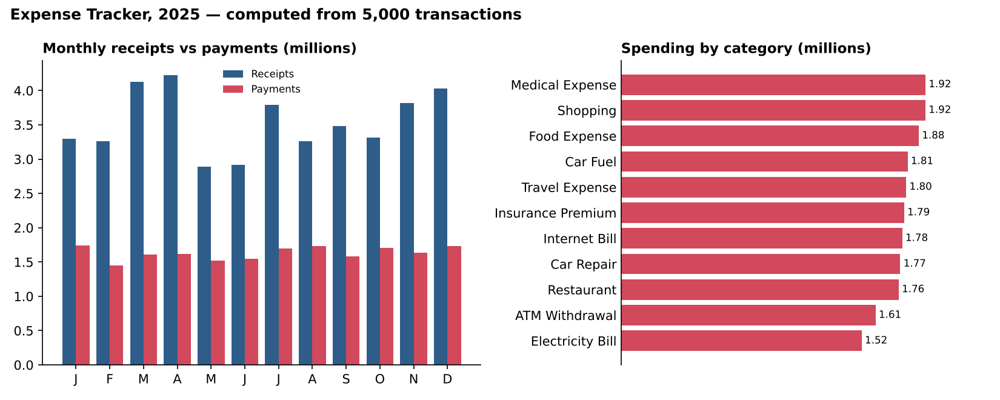

# 💰 Project 2 — Monthly Expense Tracker

A year-long bank-style ledger of **5,000 transactions** with automatic running balance, a month-by-category income & expenditure statement, Power Query tables and an interactive dashboard.

## Brief
> Create an Excel sheet to track monthly income, expenses, expense categories and savings using formulas like `SUM()` and subtraction, along with charts to visualise spending.
> — [project brief](../docs/Basic_to_Advanced_Excel_Projects_Brief.docx)

## Dataset — `Expense Tracker Data`
| Field | Description |
|---|---|
| Date | Transaction date (1 Jan – 31 Dec 2025) |
| Month | `=TEXT(date,"MMMM")` |
| Transaction Reference Number | Unique ID, e.g. `TXN2501010738` |
| Description | 7 income types (Salary, Freelance, Bonus, Dividend, Interest, Refund, Cash Deposit) and 11 expense categories (Food, Restaurant, Shopping, Medical, Travel, Fuel, Car Repair, Insurance, Electricity, Internet, ATM) |
| Receipts / Payments | Money in / money out |
| Balance | Running balance: `=previous balance + receipts − payments` |

## Workbook structure
| Sheet | Purpose |
|---|---|
| **Dashboard** | KPI cards, charts and slicer |
| **Income & Expenditure** | Month-by-category statement built with `SUMIFS` |
| **Income**, **Expenses** | Cleaned Power Query outputs (connections *Query – Income* and *Query – Expenses*) |
| **Expense Tracker Data** | Source ledger (5,000 rows) |
| Calculation sheet | PivotTables and KPI formulas (`XLOOKUP`, `MAX`, `MIN`) |

4 PivotTables · 4 charts · 1 slicer · KPI cards for *Total Expense, Most/Least Spent Expense, Least Spent Month*.

## Key figures
| Metric | Value |
|---|---|
| Opening balance | 50,000 |
| Total receipts | 42,419,671 |
| Total payments | 19,564,397 |
| Closing balance | **22,855,274** |
| Highest-spend categories | Medical (1.92M), Shopping (1.92M), Food (1.88M) |
| Lowest-spend category | Electricity Bill (1.52M) |
| Strongest receipts month | April (4.23M) · weakest: May (2.89M) |

*(Dashboard KPI cards are formatted in `$`; the amounts are sample figures.)*

## Skills demonstrated
`SUMIFS` · running-balance formulas · `TEXT` date handling · Power Query · PivotTables & slicers · `XLOOKUP` KPI cards · charting

## How to use
Open `Monthly_Expense_Tracker.xlsx` in Excel 365/2021+, use the slicer on the Dashboard to filter, and **Data → Refresh All** after changing the ledger.

---
[← Back to all projects](../README.md)
